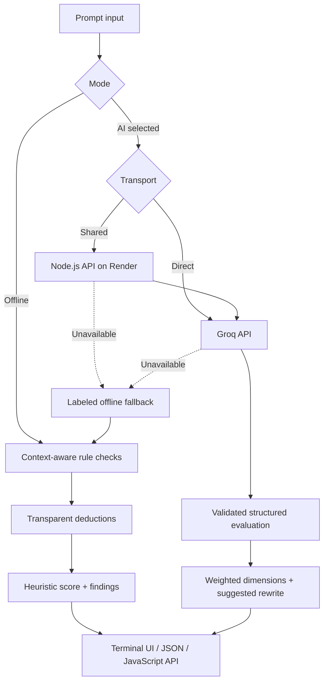

<div align="center">


# PromptLint AI

### Analyze. Score. Improve.

**A practical prompt quality toolkit for developers — offline linting, optional Groq evaluation, and clearer AI prompts, all from your terminal.**

[](https://nodejs.org/)
[](https://developer.mozilla.org/en-US/docs/Web/JavaScript)
[](https://groq.com/)
[](LICENSE)

[](https://github.com/hetjaviya15/PromptLint/stargazers)
[](https://github.com/hetjaviya15/PromptLint/commits/main)
[](https://github.com/hetjaviya15/PromptLint/issues)

[**Quick Start**](#-quick-start) · [**Features**](#-features) · [**CLI**](#-command-line-interface) · [**JavaScript API**](#-javascript-api) · [**Groq Setup**](#-groq-ai--setup) · [**Contributing**](#-contributing)

</div>

---

## ✨ Why PromptLint?

Prompts are the inputs to AI systems, but small ambiguities can lead to unexpected results. **PromptLint AI** helps you inspect a prompt *before* sending it to a language model.

- **Offline:** deterministic, explainable JavaScript rules; no API key, no network request.
- **Online:** optional Groq-powered evaluation, five-dimensional scoring and a suggested rewrite.
- **Developer-friendly:** interactive terminal, JSON output, text files, and an importable Node.js API.

> [!IMPORTANT]
> Prompt scores are **review aids**, not guarantees that a model will perform better. Offline scores are heuristic and AI scores are subjective. PromptLint does not execute prompt instructions.

## 🎯 Features

| | Feature | What you get |
|:--:|---|---|
| 🔍 | **8 offline lint rules** | Detect vague language, some missing context, simple contradictions and more |
| 📊 | **Explainable scores** | 0–100 heuristic score and rule-by-rule deductions |
| 🧠 | **Groq AI evaluation** | Clarity, context, specificity, output requirements and consistency |
| ✨ | **Prompt improvement** | Suggested rewrite, explanation, improvements and clarification questions |
| 🖥️ | **Polished CLI** | Colored panels, score bars, progress spinner, interactive menu |
| 📂 | **Flexible input** | Prompt arguments, UTF-8 files and piped standard input |
| 🧰 | **Developer API** | ESM imports, custom rule settings and programmatic reports |
| 🔒 | **Explicit online mode** | Offline by default; prompts are transmitted only when AI is selected |
| 🧾 | **Portable outputs** | JSON, plain ASCII fallback, optional copy and file export |

## 🖥️ Terminal preview

The following is a **plain-text example based on the documented offline result** for `Write good code` (not a screenshot of a live session):

```text
╭─────────────────────────────────────────────────────╮
│                    PROMPTLINT                       │
│              Analyze. Score. Improve.               │
╰─────────────────────────────────────────────────────╯

  MODE  Offline • heuristic analysis

  PROMPT QUALITY
  70/100   Needs improvement
  ██████████████░░░░░░ 70%

  ⚠ vague-language
    Potentially vague wording: good.

  ⚠ missing-context
    The programming request does not specify
    a language or framework.

  DEDUCTIONS
  vague-language     −15
  missing-context    −15

  ✓ Analysis complete
```

The real CLI adds terminal styling where supported. It also offers `--ascii` and `--no-color` for minimal or redirected output.

## 🚀 Quick start

**Requirements:** Node.js **24+** and npm.

### Run from the repository (works before npm publication)

```bash
git clone https://github.com/hetjaviya15/PromptLint.git
cd PromptLint
npm ci
npm start
```

The interactive menu lets you choose **Offline** or **Online**. Offline works without a key or an internet connection after installation.

Or try a single command:

```bash
node bin/cli.js analyze "Write good code" --offline
```

### Install a locally packed release

```bash
npm test
npm run pack:check
npm pack
npm install -g ./promptlint-ai-1.0.0.tgz
promptlint-ai --help
```

### When the package is published to npm

```bash
npm install -g promptlint-ai      # CLI
# or
npm install promptlint-ai         # Library
```

> **Publication status:** These registry installation commands apply **after** the package is published. Check [npm](https://www.npmjs.com/package/promptlint-ai) for current availability; this README does not assume it is already live.

## ⚡ Command-line interface

```bash
# Interactive start
promptlint-ai

# Offline analysis (the default)
promptlint-ai analyze "Write good code"
promptlint-ai analyze --file examples/cli-example.txt --offline

# Machine-readable output
promptlint-ai analyze "Explain recursion" --json

# Online Groq evaluation (requires working shared service or a personal key)
promptlint-ai analyze "Write good code" --ai

# AI prompt improvement
promptlint-ai improve "Write good code for a website"
promptlint-ai improve --file examples/cli-example.txt --output improved.txt
promptlint-ai improve "Write good code" --copy

# Discovery and accessible output
promptlint-ai rules
promptlint-ai --help
promptlint-ai --version
promptlint-ai analyze "Write good code" --ascii --no-color
```

Piped input is supported:

```bash
printf 'Explain recursion' | promptlint-ai analyze --json
```

**CLI behavior:** When run in a terminal with no arguments, it opens a numbered interactive menu. With redirected input, it can analyze stdin. `--json` writes machine-readable output without decorative terminal text. `--copy` requires a supported clipboard tool and `--output` saves an improved prompt to a new file (without overwriting an existing file).

## 🧪 Offline linting

Eight checks are built into the offline engine:

| Rule ID | Severity | Detects |
|---|---|---|
| `empty-prompt` | Error | Empty/whitespace-only input |
| `vague-language` | Warning | Subjective wording without clear criteria |
| `missing-context` | Warning | Task-dependent missing context or technical details |
| `output-format` | Info | Certain structured output requests lacking a format |
| `contradictions` | Error | Some explicit conflicts in output, language or constraints |
| `duplicate-instructions` | Info | Normalized repeated instructions |
| `prompt-length` | Info | Configured size thresholds exceeded |
| `repeated-text` | Warning | A word repeated at least eight times consecutively |

Offline rules are intentionally conservative and do not understand arbitrary language semantics. Simple requests like `Translate hello into French` are not penalized merely for being short.

### Tune the checks

```js
import { analyzePrompt } from 'promptlint-ai';

const report = analyzePrompt('Write good code', {
  rules: {
    'vague-language': true,
    contradictions: false
  },
  maxLength: 3000,
  maxWords: 600,
  weights: { info: 5, warning: 15, error: 30 }
});

console.log(report.score);
console.log(report.issues);
console.log(report.deductions);
```

By default, scoring starts at 100, deducts each triggered rule's severity weight once and clamps the score to 0–100. Issues and deductions provide the useful context behind any number.

## 🤖 Groq AI & setup

**AI mode is opt-in.** It evaluates a prompt using Groq and can generate a suggested rewritten version. It uses a configured shared service **or** a direct Groq key from a trusted Node.js environment.

### Option A — Shared online service

The package is configured to use `https://promptlint-api.onrender.com`. If the owner has deployed it successfully and the service has available capacity, users can choose Online mode without their own Groq key:

```bash
promptlint-ai analyze "Write good code" --ai
```

The [health endpoint](https://promptlint-api.onrender.com/health) can help check server availability, but a successful health check alone does not confirm Groq evaluation works.

**Important limits:** The documented default single-instance caps are 10 attempts/minute, 100 attempts/24 hours, two simultaneous evaluations and 8,000 prompt characters. These counters are shared among all users and held in memory; they are **not a durable billing safeguard**. Hosted service availability, provider limits and charges may apply.

<details>
<summary><b>Maintainer: deploy or configure the shared service</b></summary>

1. In Render, create a Blueprint from this repository using `render.yaml`, or deploy a Node web service manually.
2. Set the server-side `GROQ_API_KEY` as a secret. Never commit it or put it into a public client.
3. For manual setup, use the repository's documented `npm ci --omit=dev` build command, `node server/index.js` start command and `/health` health check.
4. Verify the new server URL, then configure the client package:

```bash
npm run configure:server -- https://YOUR-SERVICE.onrender.com
npm test
npm pack
```

The repository also includes `npm run server` for local backend testing. Set provider-side account controls before making a shared API publicly available.

</details>

### Option B — Your own Groq API key

Create a key at [Groq Console](https://console.groq.com/keys). In a **local, trusted Node.js environment**, configure `GROQ_API_KEY` in your shell or a private `.env` file.

For a quick local test, create an untracked `.env` file in the project directory:

```dotenv
GROQ_API_KEY=replace_with_your_key
```

For direct CLI testing, disable the packaged shared URL and supply the key in the same trusted environment:

```bash
PROMPTLINT_SERVICE_URL= node bin/cli.js analyze "Explain recursion" --ai
```

The CLI loads `.env` from its current working directory. JavaScript library imports do not automatically load `.env` files. Never use a private Groq key in a browser bundle.

> [!WARNING]
> Offline mode keeps prompts local. AI mode sends the selected prompt to the configured shared service or directly to Groq. Do not include secrets in prompts sent to online analysis.

## 🧠 AI quality scoring

AI evaluation uses five dimensions; the app computes the weighted total from the returned dimension values.

| Dimension | Weight |
|---|---:|
| Clarity | 25% |
| Context | 25% |
| Specificity | 20% |
| Output requirements | 15% |
| Consistency | 15% |

A model's opinion is not objective accuracy. Offline and AI scores stay **separately labeled**, and failed AI calls can return clearly marked offline fallback results rather than fabricated AI scores.

## ✨ AI prompt improvement

```bash
promptlint-ai improve "Write good code for a website"
```

A successful online evaluation may include an improved prompt, an explanation, a list of changes and clarification questions. Rewrite instructions ask the model to retain the user's intention and use placeholders for unknown requirements; **review all suggested rewrites** before relying on them.

## 📦 JavaScript API

```js
import {
  analyzePrompt,
  analyzePromptAI,
  improvePrompt,
  formatReport,
  getAvailableRules
} from 'promptlint-ai';

// 1. Fully offline, synchronous
const offline = analyzePrompt('Write good code');
console.log(offline.score); // 70 with the current default rules
console.log(formatReport(offline));

// 2. Online, asynchronous (shared service or direct key)
const ai = await analyzePromptAI('Create a useful portfolio website');
console.log(ai.mode);       // 'ai' on success, 'offline' on fallback
console.log(ai.score);

// 3. Rewrite with Groq when AI is available
const improved = await improvePrompt('Write good code for a website');
if (improved.mode === 'ai') {
  console.log(improved.improvedPrompt);
} else {
  console.log(improved.warnings);
}

// 4. Inspect supported offline rules
console.log(getAvailableRules());
```

| Export | Purpose |
|---|---|
| `analyzePrompt(prompt, options?)` | Synchronous offline evaluation |
| `analyzePromptAI(prompt, options?)` | Asynchronous AI evaluation, with labeled fallback |
| `improvePrompt(prompt, options?)` | AI evaluation plus improved-prompt suggestion |
| `formatReport(report, options?)` | Styled or compact report string |
| `getAvailableRules()` | Rule metadata |

For direct key use from trusted server-side code, pass an explicit `apiKey` to the AI function. For a custom shared host, use `serviceUrl`. These two explicit options cannot be combined. The documented default Groq model is `openai/gpt-oss-20b`; provider model availability may change.

## 🏗️ How it works



<details>
<summary><b>Repository layout</b></summary>

```text
PromptLint/
├── bin/                 # CLI entry point
├── src/
│   ├── ai/              # Groq, shared-client, validation, prompt improvement
│   ├── cli/             # Commands, UI, progress, clipboard
│   ├── rules/           # Offline lint checks
│   ├── analyzer.js
│   ├── scoring.js
│   ├── formatter.js
│   └── index.js         # Public API
├── server/              # Optional shared Node.js API service
├── examples/            # Example scripts and input files
├── tests/               # Node built-in test runner
├── scripts/             # Package checks, shared URL configuration
├── render.yaml          # Render Blueprint
├── package.json
└── README.md
```

</details>

## 🔐 Privacy, reliability & limitations

- **Offline is the default**, even when a Groq key is configured.
- **Explicit AI mode transmits prompt text** to the selected online service.
- No prompt history is saved by the application's documented implementation.
- The shared service uses global, restartable in-memory limits; it has no user accounts or durable quota enforcement.
- AI responses are validated structurally, but their judgments and rewrites can be incorrect.
- English-language offline heuristics can miss nuanced or indirectly contradictory instructions.
- `--copy` depends on an available OS clipboard utility.
- If AI fails, offline fallback is explicitly labeled; it does not pretend a rewrite was generated.

See the [Groq rate-limit documentation](https://console.groq.com/docs/rate-limits) for account-dependent limits.

## 🧪 Development and testing

```bash
npm ci
npm test
npm run check
npm run pack:check
npm pack
```

Automated tests are designed to run without a real Groq key; AI interactions are mocked. To run an intentional live Groq check with your key configured:

```bash
node examples/groq.js
```

That last command sends a prompt to Groq and may count toward your usage.

## 🤝 Contributing

Suggestions, issues and pull requests are welcome.

1. Fork the repository and create a feature branch.
2. Keep changes small, documented and easy to understand.
3. Add or update tests, especially for false positives and error handling.
4. Run `npm test` before opening a pull request.

[Open an issue](https://github.com/hetjaviya15/PromptLint/issues) · [View the source](https://github.com/hetjaviya15/PromptLint)

## 📄 License & author

Released under the [MIT License](LICENSE).

Created by **[Het Javiya](https://github.com/hetjaviya15)**.

<div align="center">

---

**A clearer prompt starts with a better question.**

[](https://github.com/hetjaviya15/PromptLint)

<sub>Built with JavaScript · Node.js · Groq · curiosity</sub>

</div>
